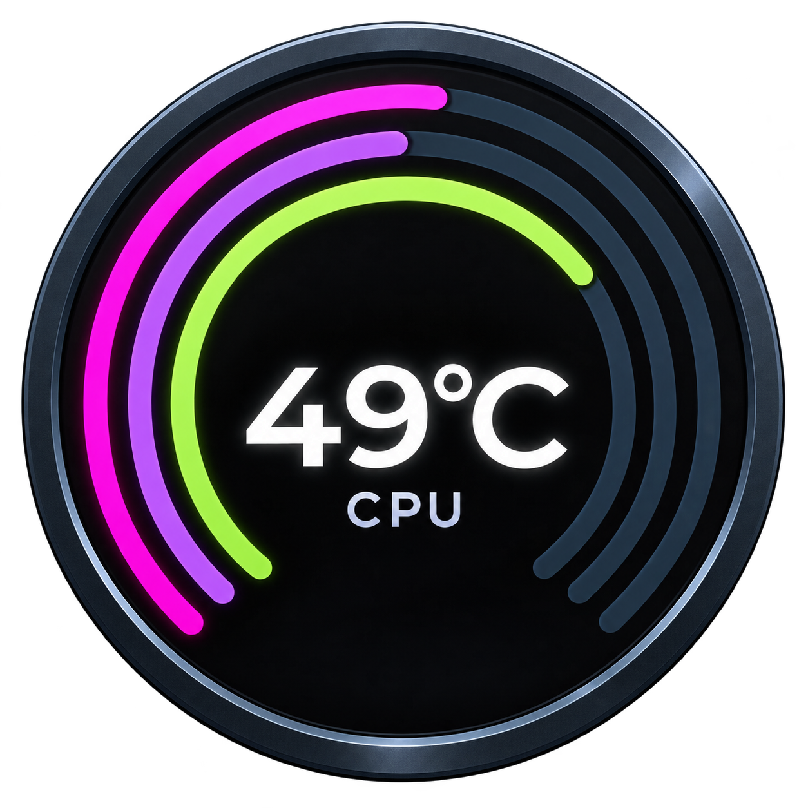
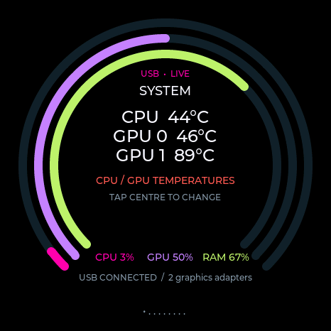
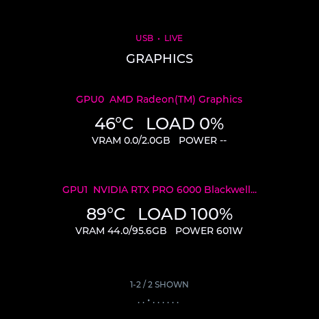
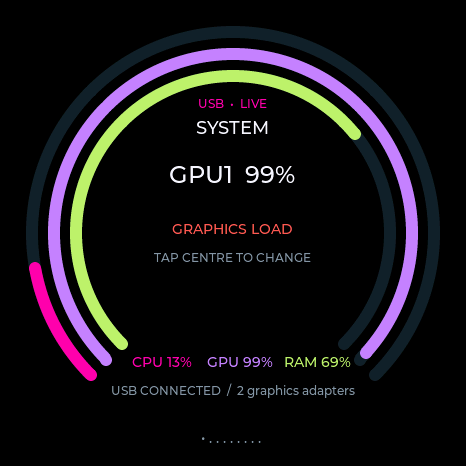

<h1 align="center">System Companion</h1>

A round desktop monitor that carries its own Windows, Linux and Mac software.

<a href="https://github.com/himwithnoname-boop/System-Companion/releases/latest">Download</a> · <a href="https://himwithnoname-boop.github.io/System-Companion/">Homepage</a> · <a href="docs/getting-started.md">Getting started</a> · <a href="docs/hardware.md">Hardware</a> · <a href="docs/troubleshooting.md">Help</a>

**Built for the Waveshare ESP32-S3-Touch-AMOLED-1.43-B:** 1.43-inch round 466 × 466 AMOLED touch display, ESP32-S3, 16 MB flash and 8 MB PSRAM. This firmware targets that board and its wiring. It is not a universal image for arbitrary ESP32 boards. [Hardware details and official resources](docs/hardware.md).

## Start here

1. Download **[SystemCompanion-Installer.exe](https://github.com/himwithnoname-boop/System-Companion/releases/latest/download/SystemCompanion-Installer.exe)** onto a Windows x64 PC or USB stick. **That one EXE is sufficient**; it contains the firmware, five clients and flashing tools.
2. Connect the matching board with a USB **data** cable. Exit Monitor and safely eject MoniStore before an update.
3. Run the installer, select the device, choose **Install / Update**, and keep USB connected until verification finishes.
4. Open the new read-only USB client drive and launch the client for your computer.

The installer checks the chip, 16 MB flash capacity, embedded image hashes and written data. It preserves the settings partition and does not format or write to your microSD card. A blank board may need **hold BOOT → press/release RESET → release BOOT**, then Refresh.

| Computer | Launch from the device | Menu |
| --- | --- | --- |
| Windows x64 or ARM64 | `Windows/Monitor.exe` | Tray: dashboard, reconnect, checked opt-in startup, Exit; optional CPU sensor access |
| Linux x64 or ARM64 | `Linux/Monitor`; use `sh ./Monitor` if USB execution is restricted | StatusNotifier/AppIndicator tray where the desktop supports it |
| macOS Apple Silicon | `macOS/Monitor.app` | Native menu bar: dashboard, reconnect, checked opt-in startup, Exit |

There are **five native builds, selected by three OS launchers**. Windows 10 and 11 use the same client. Intel macOS is not a target. No Python or development tools are needed to run the released clients or Windows installer. Launchers unpack locally into private temporary folders and clean up when the host exits. Platform permissions and enterprise policies still apply.

## What it does

- CPU and GPU temperature/load, RAM, storage, network, processes and detected **local** AI engines.
- Tap the home centre to cycle temperature, CPU load, GPU load, memory, download/upload and stacked CPU/GPU temperatures.
- Separate summaries for multiple GPUs: temperature, utilization, VRAM and available power. Up to four rows per device page; tap for more.
- **GPU0 is reserved for detected integrated graphics; discrete GPUs start at GPU1.** Hardware identities keep choices stable.
- Show/hide GPUs in the dashboard. The activity bar averages **enabled GPUs with available load**: enabled 0% + 100% = 50%; only the 100% GPU enabled = 100%. Missing readings are excluded; all disabled means no GPU reading.
- Theme, brightness, units, rotation, centre view and per-computer GPU choices stay on the device. Applied changes sync through the device to open dashboards; unapplied edits are preserved.
- Hardware accelerometer auto-rotation, BOOT hold-to-sleep/wake and immediate RESET reboot.
- Optional microSD appears as a separate writable **MoniStore** drive. Internal client storage stays available.
- Local dashboard and tray/menu-bar controls. **Closing the webpage leaves monitoring running.** Exit explicitly through the tray/menu or dashboard.
- Startup is off unless you enable it. The checked option starts monitoring at sign-in **if the display is connected**; it does not continuously poll for insertion after an absent-device startup exits.

[User guide](docs/user-guide.md) · [Sensor support](docs/sensors.md) · [Protocol](docs/protocol.md)

## Temperature support, honestly

Unavailable values appear as **--**, not invented zeroes. GPU readings depend on the graphics driver. Linux uses exposed hwmon/thermal/DRM interfaces; macOS uses available AppleSMC/IOAccelerator properties. Windows native GPU access needs no elevation when exposed by the driver.

**CPU die temperatures cannot be guaranteed without administrator rights on every Windows PC.** Native/permitted sources are used first. The optional remembered CPU helper uses an existing compatible PawnIO installation, requests Windows approval only when explicitly enabled, and installs no sensor driver automatically. Enterprise policy may prevent it; other monitoring remains useful. Generic thermal zones are labelled separately.

The preceding Windows x64 release was hardware-tested; the new LCD-ID helper has build/protocol tests and awaits physical confirmation. Older Linux x64 USB/tray operation was tested in Ubuntu; the newest native sensor provider, Linux ARM64, Windows ARM64 and macOS menu/SMC runtime still need target-machine checks. Cross-compilation is not proof of physical compatibility. See [verification boundaries](docs/verification.md).

## Screenshots

These three device images are actual USB framebuffer captures. The installer icon is generated artwork inspired by the home display. The [gallery](docs/screenshots.md) identifies real captures and demonstration data.

## Develop and contribute

ESP-IDF firmware, Go clients, a local HTML dashboard, a C# installer GUI and a bundled esptool worker.

- [Build from source](docs/building.md)
- [Architecture](docs/architecture.md)
- [Contributing](CONTRIBUTING.md)
- [Security and privacy](SECURITY.md)
- [Changelog](CHANGELOG.md)

Release assets include the installer, portable client-drive package, firmware images, SHA-256 checksums, and third-party source archives. Large build outputs, private test logs, device backups and credentials are excluded from Git.

## Credits and licence

Created and maintained by **[himwithnoname-boop](https://github.com/himwithnoname-boop)**, developed with assistance from OpenAI Codex. Thanks to Waveshare for board documentation and examples, Espressif for ESP-IDF and esptool, LVGL, LibreHardwareMonitor and the other upstream projects.

Original project code is **[MIT licensed](LICENSE)**. Bundled dependencies retain their own terms; the esptool component is GPL-2.0-or-later, sensor libraries include MPL-2.0, and fonts have their own licences. Read [credits](CREDITS.md), [third-party notices](THIRD_PARTY_NOTICES.md) and [licence texts](licenses/). There is no affiliation or endorsement by the hardware, OS or payment providers.

## Support development

If System Companion is useful, you can support its development through PayPal. Donations are optional and do not unlock features.

[Open the PayPal donation link](https://www.paypal.com/qrcodes/managed/24bd8675-7502-481e-896a-fe600f6b8e8e?utm_source=consweb_more)
