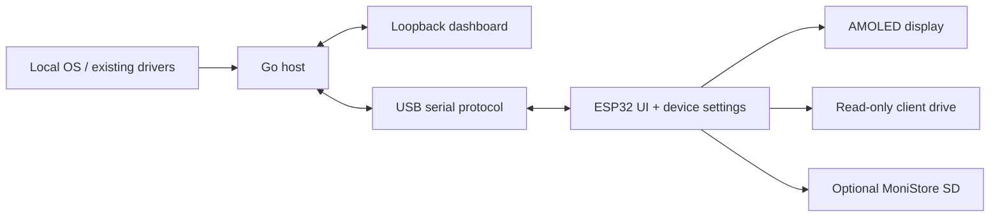

# Architecture

The Go host collects metrics through bounded cached providers, normalizes GPU identities, exposes a loopback dashboard and sends a bounded NDJSON stream over USB serial. Slow or absent providers back off and expire cached values. One persistent NVIDIA reader avoids launching a command for every sample.

The device combines ESP-IDF, TinyUSB and LVGL. USB input is queued onto the UI thread. A 13 MiB internal partition holds compressed offline clients; settings use a separate NVS partition. The optional microSD is a separate mass-storage unit.

Visibility filters are applied after full GPU collection. The device-facing aggregate is the mean of enabled, available loads. The dashboard computes the same mean from the full inventory and its saved/draft selection. Device selection profiles use stable host and GPU identities.

Dashboard closure only stops that page's polling. Host shutdown requires an explicit Exit request, tray/menu action or OS signal. Settings writes wait for device confirmation, and polling preserves unapplied control drafts.

The standalone Windows installer contains a C# GUI, an isolated Python/esptool process, the board images and a manifest. It verifies bundle hashes, selected serial identity, chip and flash size before writing the image regions, then checks device boot. It never formats the SD card or erases NVS.
